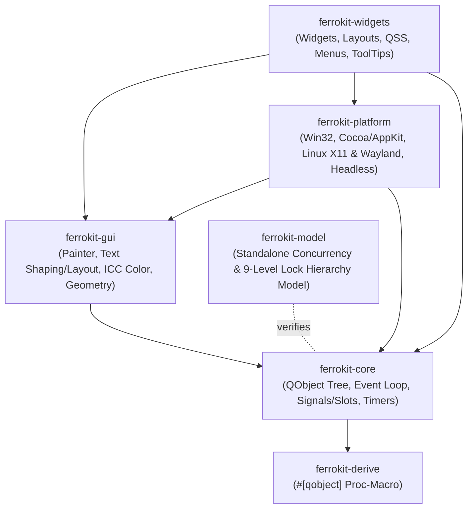

# ferrokit Architecture

`ferrokit` is a modular Rust GUI toolkit implementing a subset of Qt 6.11 semantics across 6 crates:

## 1. Crate Responsibilities

| Crate | Workspace | Responsibility |
|---|---|---|
| `ferrokit-core` | Yes | `QObject` parent/child ownership, `ObjectId` generational handles, properties & meta-calls, per-thread event loop (`Win32`, `Cocoa`, `EpollReactor`), signals & slots (`Direct`, `Queued`, `BlockingQueued`, `Unique`), timers, and thread affinity (`move_to_thread`). |
| `ferrokit-derive` | Yes | Procedural macro (`#[qobject]`) generating `QObject` boilerplate, property descriptors, and meta-object metadata. |
| `ferrokit-gui` | Yes | `tiny-skia` software painter, `QPath`/stroking, ICC color space transforms, `rustybuzz` + `skrifa` + DirectWrite/CoreText/Fontconfig shaping and layout, QSS parser. |
| `ferrokit-platform` | Yes | Native windowing, screens/DPI, surfaces, cursors, clipboards, system tray icons, menus, dialogs, global hotkeys, IME, and `raw-window-handle` 0.6 integration. |
| `ferrokit-widgets` | Yes | Widget tree (`Rc<RefCell<Box<dyn Widget>>>`), `BoxLayout`/`GridLayout`, QSS styling, `Menu`/`Popup`/`ToolTip`/`SystemTrayIcon`/`KeySequenceEdit`, hit-testing, and accessibility tree snapshot. |
| `ferrokit-model` | Standalone | Self-contained formal/executable concurrency model mirroring `ferrokit-core`'s locking and re-entrancy protocol for `loom`, `shuttle`, `ThreadSanitizer`, and `kani` verification. |

## 2. Core Object Model, Event Loop & Concurrency

- **Object Registry & Teardown**: Objects are tracked by `ObjectId` with generational IDs and borrow flags (`ObjectBorrowState`). During `ObjectData::drop`, `destroyed` signals emit before child detachment and `unregister_qobject` (wrapped in `catch_unwind` so slot panics cannot leak children or registry entries).
- **Signal Delivery**: `Signal<T>` supports `AutoConnection`, `DirectConnection`, `QueuedConnection`, and `BlockingQueuedConnection`, plus `UniqueConnection` deduplication via `SlotKey` and `SenderGuard` tracking.
- **9-Level Lock Hierarchy (`ferrokit-model`)**: To prevent deadlocks across `GLOBAL_OBJECTS`, `GLOBAL_OBJECT_THREADS`, `GLOBAL_CONNECTIONS`, thread queues, and per-object borrows, lock acquisition follows a strict 9-level partial order enforced in tests under `std`, `loom`, `shuttle`, and `ThreadSanitizer`.

## 3. Painting & Text Pipeline

- **2D Rendering**: `ferrokit-gui` renders into RGBA8 `Pixmap` buffers via `tiny-skia` and custom `solid_fill` / `text_blend` / `qss_box` blitters, with ICC color space calibration (`icc.rs`) and QSS CSS-box border/radius rendering.
- **Text Shaping & Rasterization**:
  - Shaping uses `rustybuzz` (`HarfBuzz` port) with `unicode-bidi`, `unicode-linebreak`, and `unicode-segmentation`.
  - Font enumeration and glyph rasterization dispatch to DirectWrite (`windows` crate on Windows), CoreText (macOS), and `fontconfig` + `skrifa` + `ab_glyph_rasterizer` (Linux), with `OutlineFace` as the generic outline fallback.

## 4. Platform Backends (`ferrokit-platform`)

| Subsystem | Windows | macOS | Linux (X11) | Linux (Wayland) | Headless / Fallback |
|---|---|---|---|---|---|
| **Window** | Win32 `HWND` (`win32.rs`, `win32_wndproc.rs`) | AppKit `QNSWindow`/`QNSView` (`objc2 0.6`, `window/macos.rs`, `macos_input.rs`) | Pure-Rust `x11rb` (`window/x11.rs`, `XcbWindowHandle`) | Pure-Rust `wayland-client` (`xdg-shell` + `wlr-layer-shell`, `window/wayland.rs`) | `GenericWindow` / `new_offscreen` |
| **Surface** | Typed `windows 0.62` `DCompSurface` (DXGI `Present1`) + Win32 GDI `LayeredSurface` | `CocoaLayerSurface` (`CALayer`) | `X11LiveSurface` (`put_image` chunking) | `WaylandLiveSurface` (unlinked `wl_shm` file, zero `unsafe`) | In-memory pixel buffer |
| **Screen / DPI** | `Win32Screen` (`EnumDisplayMonitors`, per-monitor DPI) | `CocoaScreen` (`NSScreen`) | `X11Screen` (XRandR + `_NET_WORKAREA`) | `WaylandScreen` (`wl_output`) | `GenericScreen` (`1920x1080`) |
| **Clipboard** | `Win32Clipboard` | `CocoaClipboard` (`NSPasteboard`) | `X11Clipboard` (`CLIPBOARD` selection thread) | `GenericClipboard` | `GenericClipboard` |
| **Tray & Menu** | Win32 `Shell_NotifyIconW` + `HMENU` | `CocoaStatusItem` + `CocoaMenu` (`objc2 0.6`) | D-Bus `StatusNotifierItem` (`dbus_connection.rs`) + `DBusMenu` | D-Bus `StatusNotifierItem` + `DBusMenu` | `GenericTrayIcon` |
| **Dialogs** | `tinyfiledialogs` (mutex-serialized) | `CocoaDialogs` (`NSOpenPanel`/`NSAlert`) | `tinyfiledialogs` (mutex-serialized) | `tinyfiledialogs` (mutex-serialized) | — |

## 5. Verification Pyramid

- **Cross-Platform CI (`.github/workflows/ci.yml`)**:
  - `Workspace Test` on `windows-latest`, `ubuntu-22.04`, and `macos-latest` (including live AppKit main-thread checks via `examples/appkit_main_thread.rs` and `examples/main_thread_entry.rs`).
  - `Workspace Test (ubuntu-22.04, Xvfb)` running live X11 window/surface/clipboard tests under `xvfb-run`.
  - `Clippy` (`windows-latest`, `ubuntu-22.04`, `macos-latest` arm64 + `x86_64-apple-darwin`) and `Rustfmt check`.
  - `License Check (cargo-deny)` verifying `deny.toml` against `Cargo.lock`.
- **Memory & Concurrency Verification**:
  - **Miri (`.github/workflows/miri.yml`)**: Stacked Borrows & Tree Borrows sweeps across `ferrokit-core`, `ferrokit-gui`, and `ferrokit-widgets` against tracked baselines (`tools/miri_baseline*.json`).
  - **Concurrency Models**: `ferrokit-model` verified with `loom`, `shuttle`, and `ThreadSanitizer` (`-Zsanitizer=thread`).
  - **Fuzzing**: `fuzz/` harnesses (outside workspace, nightly `cargo-fuzz`) for QSS, ICC, PNG, and outline parsers.
